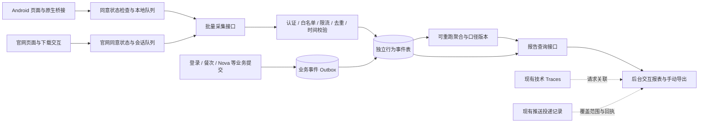

# Nordic Nutri 用户行为分析与报告系统设计

> 日期：2026-10-20
>
> 状态：设计草案，待产品审阅；本文件不表示已实施或已部署。
>
> 已确认：覆盖 Android App、官网及管理后台；报告采用“后台交互分析＋手动导出”，不自动发送邮件或消息。
>
> 基线：`8e6a9f6`；现有 Google 原生登录修复仍是独立本地改动，不并入本设计。
>
> 环境：DEV `test-dev-d4gyxnn0b5dfa2c8a`；PROD `lewis-healthy-d4glgqqzv73a5bc10`。

## 1. 产品目标与范围

系统应让运营者判断：推广是否带来有效访问、用户在哪一步流失、是否完成首餐记录、是否持续使用，以及哪个版本的哪条功能链路容易出错。

首期完整交付范围包括：

1. 官网渠道与下载点击分析。
2. App 会话、页面与核心行为采集。
3. 服务端业务成功确认及客户端体验关联。
4. 前端和原生异常、Nova 流式中断、推送回执覆盖情况。
5. 统一后台：总览、渠道、漏斗、留存、功能、质量与手动报告。
6. 事件字典、采集偏好、数据保留、删除、DEV/PROD 隔离与验收。

本轮仅产出设计。不执行数据库迁移、埋点开发、第三方 SDK 接入、APK 构建、线上部署或定时任务创建。

本版本不包含广告投放自动优化、用户画像营销、会话录像、触摸热图、跨站指纹、自动邮件报告。微信小程序暂不纳入行为分析分母；以后接入时增加独立平台，不与 Android 混算。

## 2. 当前实现及复用边界

| 当前模块 | 事实与使用边界 |
|---|---|
| `mini-program/src/app.tsx` | 已有启动、前台恢复和提醒初始化；尚无统一产品行为采集器 |
| `mini-program/src/auth/` | 账号与会话管理；可接入登录后身份关联，不能把刷新 Token 当作用户活跃 |
| `mini-program/src/platform/google-auth.ts` / Android `GoogleAuthBridge.java` | 原生登录边界；需报告安全错误类型，不能只依赖后端登录请求 |
| `mini-program/src/api/coach-api.ts` | 有流式请求、完成和取消边界；可区分生成完成与用户实际展示完成 |
| `mini-program/src/features/smart-reminders/push-coordinator.ts` | 已有部分接收／展示／打开回执；必须标注真实可观测范围 |
| `sites/nordic-public/src/site.js` | 官网演示与下载交互；检查源码未发现统一行为事件上报。平台侧额外统计是否启用需实施时核对 |
| `get-login-ticket/observability-service.cjs` | 已有接口 Traces、模型指标、耗时与审计；继续服务于技术排障，不替代用户行为模型 |
| `ops_metric_events` / `ops_request_traces` | 可作为排障关联来源；不能把轮询次数、接口次数或模型分段数量当成用户数 |
| `cloudbase/admin/food-images.html` | 现有管理壳、环境标识、筛选器、表格、反馈和分页；新分析模块复用这些组件与样式 |

特别约束：现有指标读取有 5000／10000 行上限，新报表不得取“最近 N 条”后在浏览器算总数。所有报表按完整过滤条件在数据库聚合，列表分页与总数使用同一口径。

## 3. 方案比较与选择

| 方案 | 优点 | 代价／限制 |
|---|---|---|
| A. 自有事件采集＋CloudBase PG＋现有后台（推荐） | 与账号、餐次、Nova、Trace 关联清楚；国内用户不额外依赖 Google；看板和隐私策略由项目控制 | 需要维护事件字典、聚合、数据质量和清理 |
| B. 第三方产品分析 SDK 为主 | 成熟的漏斗、留存与调试界面 | 引入 SDK、供应商数据流、网络和计费依赖；仍需自建业务成功确认 |
| C. Cloudflare 流量统计＋现有接口日志 | 上线快，适合基础访问和排障 | 不能独立覆盖 App 留存、精确业务漏斗及官网自定义行为 |

采用 A。Cloudflare 基础访问／性能统计可作为辅助来源，与自有口径分开展示。产品分析主链不要求 Google 登录成功、Google Play 可用或 FCM 连通。

## 4. 总体架构



App、官网只提交受限的行为事件。登录用户身份从服务端验证后的会话得出；不信任客户端自报的用户 UUID、事件来源或“业务已成功”。

产品事件与运维日志分表、分权限、分保留策略。共用现有 HTTP 函数的认证与运行环境，新增模块文件承载业务，不继续把分析计算堆入主 `index.js`。

## 5. App 端设计

### 5.1 对用户可见的界面

保留现有业务页面布局、字号、标题栏、返回位置和动画。采集本身不增加业务流程中的按钮、加载状态或弹窗。

“我的 → 帮助与信息”增加“隐私与数据”，进入后提供：

| 项目 | 展示与行为 |
|---|---|
| 使用情况分析 | 说明用途，独立开关；用于页面、功能使用和留存分析 |
| 诊断数据分享 | 独立开关；用于客户端／原生异常、设备大类与性能诊断 |
| 数据说明 | 展示字段类别、保留期、服务提供方、撤回方式 |
| 权利入口 | 引导到现有反馈和账号注销流程，不展示原始事件 UUID |

页面复用 `PageLayout`、现有设置行与开关，标题字号和返回栏以“我的常吃”为对齐基准。zh-CN、zh-TW、en 三语完整覆盖，时间与正文不被全局标题样式放大。

新增可选分析默认关闭。在首次适当时机使用项目现有反馈／说明组件提供“允许使用情况分析”和“暂不启用”两个清晰操作；拒绝不妨碍注册、Google 登录、识图和记录。诊断分享独立选择，不与分析、推送权限或服务条款捆绑。

既有账号升级后也需获得新用途的明确选择，不把过去同意隐私政策等同于同意新采集。语言与采集开关属于必要偏好存储；未选择前不生成持久分析标识、不排队可选行为事件。

### 5.2 启动、会话、页面

- `app_foreground`：已允许分析，App 进入可见前台并持续至少 2 秒后，每次前台周期最多一次；初始化、后台同步、定时器均不触发。
- `session_start`：首次有效前台或离开前台达到 30 分钟后重新进入；短暂切换 Google 弹窗不新增会话。
- 页面浏览：页面实际可见且稳定 500ms 后记录一次；React 重渲染不重复，真正离开再回来可新增。
- 页面时长：仅累计前台且页面可见时间，采用单调时钟；进入后台暂停，单次片段上限 30 分钟。
- `first_observed_open`：某个获得同意的安装标识第一次被观测到，后台名称为“首次观测安装”，不能宣称是完整历史安装量。
- 旧版升级后第一次支持埋点不计为“真实首次安装”；记录 `observation_origin=existing_install/new_install/unknown`，未知不推断。

### 5.3 本地队列与传输

| 项目 | 设计默认值 |
|---|---|
| 上传 | 队列达到 20 条或前台每 15 秒一次；单批最多 50 条、请求体最多 64KiB |
| 队列容量 | 最多 1000 条或 2MiB，先到者触发限额；同意偏好与业务存储独立 |
| 队列寿命 | 72 小时；超过后删除并累计本地丢弃原因计数，不发送过期明细 |
| 重试 | 网络失败、408、429、5xx 指数退避并抖动，遵守 `Retry-After`；每次前台周期最多 5 次自动尝试 |
| 部分接收 | 按事件 ID 处理接收／重复／永久拒绝；只重试临时失败项 |
| 退出／切账号 | 结束当前身份片段；队列按已认证主体隔离，绝不把 A 的排队事件用 B 的会话发送 |
| 撤回 | 立即停止相应类型、清空队列和标识；后续恢复生成新分析代次，不补报撤回期间行为 |
| 后台与杀进程 | 尽力持久化，下一次前台补传；不引入保活服务、不保证退出进程前最后一次上报必达 |

登录失效时不调用现有“自动刷新／登录”链路来强行补报分析数据；暂停认证事件。队列中带账号归属的事件不得降级成匿名重新发送。

原生异常与业务事件之间只传结构化字段。Google 异常记录阶段与平台错误类型；Nova 不按每个 token／分段写事件。

## 6. 官网采集与渠道

官网覆盖中文简体、繁体与英文，页面与演示功能保持现状。提供轻量“使用情况分析”选择及页脚“隐私设置”入口；拒绝后仍可体验和下载。未同意前不使用持久分析标识。

首批事件包括页面访问、核心功能区曝光、识图示例开始／完成、Nova 示例开始／完成、下载点击。曝光条件为元素至少 50% 可见且持续 1 秒，每次页面访问最多一次。

下载区分三层：

1. `apk_download_clicked`：浏览器的用户点击，只能说明意向。
2. `apk_response_started`：下载处理层实际开始响应；如现有静态托管不能可靠提供该信号，报表显示“不支持”，不得由点击补造。
3. App `first_observed_open`：安装后首次被观测；与前两项分别统计。

未来若新增下载观测 Worker，必须保留 Range／断点续传、缓存、原始 APK 字节和散列；重复 Range 请求不得算多次下载。本版优先交付点击指标，不为统计阻断或代理 APK 下载。

渠道参数白名单：`utm_source`、`utm_medium`、`utm_campaign`、`utm_content`、项目渠道码；单值最多 80 字符，只允许已登记值或安全枚举。完整 URL、任意 query、Referer 路径、搜索词和用户输入不上报。

官网首次渠道与最近一次非直接渠道分开保存，归因窗口为 7 天；直接访问不覆盖有效的最近非直接渠道。未携带参数的社交平台内置浏览器流量归为“未知／直接”，不猜测具体笔记。

首版明确展示两个漏斗：官网访问→演示→下载点击；App 首次观测→登录→首餐。**不默认把同一时间段的两端人数当作跨端转化。**

如后续启用渠道码，后台只通过显式绑定的有效渠道码建立跨端归因，保留 `attribution_method` 与覆盖率；不使用 IP、UA、健康数据或硬件指纹推断匹配。

## 7. 身份、同意与可信来源

| 标识 | 生命周期与约束 |
|---|---|
| `anonymous_id` | 获得分析同意后生成；官网和 App 独立随机标识，不采用硬件 ID |
| `session_id` | 同一前台会话；官网每标签页独立，30 分钟无活动后重建 |
| `actor_key` | 服务端生成的环境隔离伪名标识；属于可关联数据，不称为完全匿名 |
| `operation_id` | 一次识图、一次提问等用户意图；自动重试不变，用户再次主动操作产生新的值 |
| `attempt_id` | 同一操作的一次实际尝试，用于失败／重试诊断 |
| `trace_id` | 对接现有服务端追踪；可选，不等同于用户或会话标识 |
| `event_id` | 事件产生时生成，排队与重试不变 |
| `consent_revision` | 同意版本与代次；服务端拒绝已撤回／已注销代次的迟到事件 |

登录后的关联仅在同意有效时由服务端建立。允许关联当前会话中明确属于同一登录过程的匿名事件；不把同一安装过去所有匿名历史归给后来登录的人。

退出账号后旋转匿名片段；切换账号不合并两人的历史。账号注销完成后删除其原始行为、身份映射、个体日汇总与已生成含个体信息的导出；重算受影响聚合，阻止旧代次排队事件复活。App 必须清空注销账号对应队列。

已登录状态通过现有身份接口同步分析偏好。匿名采集同意记录使用服务端签发的短期收集凭证关联代次，并限流；该凭证只能用于提交自己会话的数据，不具有用户认证或数据读取能力。

新旧多个设备的偏好采用服务端最新同意版本；匿名偏好不自动开启其他设备的分析。诊断与行为分析可独立撤回。必要的服务安全日志与业务记录维持原目的、原权限，不因用户关闭可选分析而停止服务保护。

## 8. 事件协议与字典

统一字段：`event_id`、`event_name`、`schema_version`、`occurred_at`、`session_id`、`anonymous_id`、`consent_revision`、`platform`、`app_version`、`build_code`、`page_key`、可选 `operation_id`／`attempt_id`／`trace_id`、白名单 `properties`。

服务端补齐：`received_at`、部署决定的 `environment`、已验证的 `actor_key`、真实 `source`、`effective_at`、`timestamp_quality`、`is_test`。客户端不能把 `source=server` 或伪造用户身份作为成功凭据。

安全维度限于语言、App 版本、Android 主版本、粗粒度网络类型、受控渠道和页面枚举。不采集 GPS、通讯录、广告 ID、IMEI、完整 IP、照片、体重、营养数值、邮箱、手机号、Token、验证码、对话正文或完整原生错误消息。异常堆栈只保留模块／函数／构建映射，剔除 URL 参数、路径中的用户值与任意消息文本。

事件名统一为小写 snake_case；事件版本可独立升级。未知事件、未知属性、类型错误、超长字段在入库前永久拒绝并返回安全原因；不把整个请求体写入日志。schema 版本不兼容时拒绝，不悄悄丢字段后当成有效数据。

### 8.1 V1 核心事件

| 事件 | 触发点／权威来源 | 属性与去重键 |
|---|---|---|
| `web_page_view` | 官网页面可见稳定后／浏览器 | `page_key, locale, campaign`；页面访问 ID |
| `web_section_view` | 官网页面区块达到曝光条件 | `section_key`；页面访问＋区块 |
| `web_demo_started` / `web_demo_completed` | 识图／Nova 示例交互 | `demo_kind, sample_key`；一次示例操作 |
| `apk_download_clicked` | 明确点击下载链接 | `placement, release_version, campaign`；一次操作 |
| `first_observed_open` | 首次允许采集的安装观测／App | `observation_origin`；安装分析代次 |
| `app_foreground` / `session_start` | 有效前台／新会话 | `entry_kind`；前台周期／会话 |
| `screen_view` / `screen_engagement` | 路由显示／可见片段结束 | `page_key, duration_ms`；页面访问／片段 |
| `auth_started` | 点击邮箱／手机号／Google 登录 | `method, entry`；操作 ID |
| `google_credential_result` | 原生 Google 回调 | `outcome, error_type, stage`；尝试 ID |
| `auth_completed` / `account_registered` | 服务端会话／账号创建成功 | `method`；实际业务结果 ID |
| `onboarding_completed` | 服务端保存引导结果 | 不包含引导答案；业务结果 ID |
| `scan_opened` / `image_upload_result` | 扫描入口／上传结算 | `entry, outcome, error_code, duration_ms`；操作／尝试 |
| `vision_started` / `vision_terminal` | 服务端接受／终态 | `outcome, error_code, duration_ms`；分析任务 ID＋终态 |
| `vision_result_viewed` / `vision_result_edited` | 前台看到／修改结果 | `edited_fields` 仅字段类别；操作 ID |
| `meal_save_clicked` / `meal_saved` | 用户点击／服务端提交成功 | `entry=scan/manual/template`；操作／餐次创建结果 ID |
| `meal_updated` / `meal_deleted` | 服务端业务提交 | 操作类型，无餐食内容；业务结果 ID |
| `template_saved` / `template_used` | 常吃保存／一键记录成功 | 入口枚举；业务结果 ID |
| `nova_request_started` / `nova_first_chunk` | 发问／首次有效内容到达 | `entry, first_chunk_ms`；请求／尝试 ID |
| `nova_server_terminal` | 服务端生成结算 | `outcome, error_code`；请求 ID＋终态 |
| `nova_display_terminal` | 页面展示完成／中断 | `outcome, reason, duration_ms, received_chunk_count`；尝试 ID＋终态 |
| `notification_permission_result` / `reminder_updated` | 系统权限查询／提醒设置保存 | `status, enabled_count`；状态变化／业务结果 ID |
| `push_delivery_event` / `notification_read` | 已校验的投递回执／阅读提交 | `stage, notification_kind, observation_method`；投递 ID＋阶段 |
| `feedback_submitted` / `feedback_reply_viewed` | 提交成功／用户打开回复 | 无反馈正文；业务结果 ID |
| `account_binding_result` | 绑定结算 | `method, outcome, error_code`；操作 ID |
| `update_checked` / `update_clicked` / `version_observed` | 更新检查／点击／启动观测版本 | `from_version, target_version`；操作／安装版本 |
| `client_error` | 前端异常／诊断同意有效 | `error_fingerprint, module, error_type, severity`；事件 ID |
| `native_diagnostic` | 原生错误、可采集的崩溃／ANR | `error_fingerprint, stage, error_type`；事件 ID |

原生崩溃、ANR 作为明确独立交付项：实施时验证系统诊断接口在目标 Android 版本上的可用性与覆盖率，旧系统不支持时显示未知；不以 JS 异常数量宣称完整原生无崩溃率。严重进程退出可在下一次启动补报；用户未再打开 App 时不保证获取。

`meal_saved` 的业务创建结果与 `template_used` 可共享同一操作关联，但全局“成功记录餐次”只数 `meal_saved`。同一业务事件由客户端和服务端同时观察时保留来源，核心指标只取权威来源，禁止双计。

### 8.2 Nova 与推送的特殊口径

- Nova 有效完成：收到协议终态且页面内容完整提交，不能把 TCP 断开或最后一段文字到达当成完成。
- 区分 `completed / user_cancelled / navigation_cancelled / background_cancelled / network_failed / timeout / protocol_error / provider_failed / unknown`。
- 服务端完成而客户端未观察到：显示“生成完成、客户端结果未知”，不自动算“已展示”或“用户流失”。
- 原生通知 `accepted` 只表示推送服务接受；`received`、`displayed`、`opened` 各自独立。点击后推断先前展示的回执必须带 `observation_method=inferred_from_open`，不得混入直接展示率。
- 每项推送报表展示可观测覆盖率；OS 代展示且没有回调时状态为未知，不能按 0 填充。
- App 业务未发送到接口之前的原生 Google 失败，在“登录漏斗／错误分布”中单独成段；纯服务端 Traces 无法补齐该段。

## 9. 上报、业务确认与存储

### 9.1 接口合同

| 接口（新增设计） | 行为 |
|---|---|
| `POST /analytics/consent` | 记录分析／诊断选择，签发或撤销相应收集代次；账号身份取现有认证 |
| `POST /analytics/batch` | 最多 50 条／64KiB，返回各 `event_id` 的 accepted、duplicate、rejected 和安全原因 |
| `GET /admin/analytics/...` | 复用现有管理员会话守卫；按模块返回完整过滤后的聚合与分页 |
| `POST /admin/analytics/reports` | 手动建立报告任务，固定筛选和数据水位；返回任务 ID |
| `GET /admin/analytics/reports/:id` | 查询报告状态、摘要、过期时间；下载前再次校验管理员身份 |

公开采集入口没有业务读取权限。部署环境固定来源，DEV Payload 投到 PROD 时不依赖其自报 environment；收集凭证须属于当前部署环境。官网只允许已登记 Origin，App 使用自身收集会话；Origin/CORS 不是认证替代品。

匿名频率初值：每收集会话每分钟 120 条、IP 短窗口辅助限流、每安装每日 5000 条。IP 只用于短期防滥用，不作为行为标识，不进入分析表。限制均在服务器配置，不能由客户端放大。触发限流返回 429 与重试间隔，不影响业务接口配额。

服务端不信任客户端 timestamp：接收时校验 UTC 格式、72 小时迟到窗口和最多 10 分钟未来偏移。已建立可靠服务器时差时修正；否则使用接收时间作为 `effective_at` 并标记不可信，不用于跨步耗时计算。未来超过限值或迟到超过窗口的行为拒绝；原生诊断可保留接收日计数并标记发生日未知。

### 9.2 数据对象

以下为逻辑模型；实施阶段先检查已有 schema，再生成新的 14 位 UTC 版本迁移。

| 对象 | 关键内容与约束 |
|---|---|
| `analytics_events` | 受控事件明细；UUID、事件版本、两种时间、主体、会话、操作／Trace、白名单属性；时间分区；跨分区去重不能只靠分区内唯一键 |
| `analytics_ingest_receipts` | 全局 `environment + event_id` 去重回执，保存 7 天，覆盖 72 小时重试窗口；批量原子认领，不使用先查再插 |
| `analytics_identity_links` | 服务端持有账号和伪名关联、当前同意代次；不允许客户端读写 |
| `analytics_consent_records` | 必要的同意／撤回凭证与版本；与可选行为明细分开，账号注销时按已批准保留策略处理 |
| `analytics_outbox` | 业务事务内记录待投递事件；业务幂等键唯一，投递成功后保留 7 天或聚合已结算再清理 |
| `analytics_daily_actor_facts` | 主体×统计日×受控维度，保存活跃／登录／首餐事实、功能计数、耗时分布和渠道／版本贡献；用于精确去重、留存及删除后的汇总重算，不含健康内容 |
| `analytics_metric_daily` | 指标×日期×受控维度的可重算汇总；独立 `metric_version` 和数据水位 |
| `analytics_error_groups` | 脱敏错误指纹、版本、次数、影响主体数、状态及关联 Trace |
| `analytics_report_jobs` | 手动导出任务、创建人、固定查询、水位、文件状态、过期时间；文件只存私有 Storage |

索引优先覆盖时间＋事件、主体＋时间、操作 ID、错误指纹；单批参数化写入。避免任意 JSON 属性作为无限维度索引。

业务事务 Outbox 只用于用户同意有效的产品事件，继承撤回检查。不能为了增加行为统计把原本成功的餐次业务改成依赖远程分析服务；Outbox 与业务在同一数据库事务提交，派发在事务之后独立重试。

客户端事件不升级为可信业务结果。报表将“客户端发起量”“服务端接受量”“业务成功量”分开；分析同意关闭用户的必要业务与运维记录不会自动写入可选产品明细。

### 9.3 聚合和数据新鲜度

- 行为采集不做比例采样；首版保留所有通过校验且符合偏好的事件。限额／拒绝／不支持的观测单独展示。
- 每 5 分钟派发与增量聚合；每天重算最近 4 个自然日，覆盖 72 小时迟到。用 upsert 替换桶，重跑不叠加计数。
- 调度有租约、幂等和任务日志，失败只标记报表延迟，不回写业务状态。
- 今日指标显示“进行中”；上一完整日结束 72 小时后标为“已结算”。历史更正触发受影响桶和报告版本更新，已导出文件保持原快照并标记版本。
- 耗时保留可合并的固定直方图，桶上界为 50、100、200、500、1000、2000、5000、10000、20000、30000、60000、90000、180000、300000 毫秒及溢出桶。跨日 p50／p95 合并桶计数后计算，标为“估算”；溢出分位显示“大于300秒”。不能平均各天 p95；转化率用合并后的分子／分母重算。
- 多日独立用户用 actor facts 去重，不能相加每日 DAU。官网访客、安装主体、登录账号分别显示，不跨标识直接加总。

## 10. 指标口径

统一报表时区为 `Asia/Shanghai`，日期范围为起日 00:00 到止日次日 00:00 的左闭右开区间；数据库时间保留 UTC 语义。事件发生时间经过校验后形成 `effective_at`，客户端上报和业务事件使用同一规则。

| 指标 | V1 定义 |
|---|---|
| 官网访问 PV | 同意有效的 `web_page_view` 事件数；机器人过滤为尽力识别，不宣称绝对真实人数 |
| 官网访客 | 范围内去重的官网分析标识；清除存储、换浏览器会新增标识 |
| 下载点击率 | 去重的下载点击访客／同期有效访问访客；展示计数及分母 |
| 首次观测安装 | 安装分析标识第一次被观察到；历史旧包／拒绝采集的安装不在分母 |
| DAU | 当天有有效 `app_foreground` 或允许的明确交互事件的去重账号；未登录安装活跃单列；后台轮询、推送静默接收、Token 刷新排除 |
| 注册成功 | 服务端 `account_registered` 业务结果去重；区分创建账号方式与推广来源 |
| 首餐转化 | 注册 cohort 内 24 小时完成首个服务端 `meal_saved` 的账号／该 cohort 可观察注册账号；窗口未满列为观察中 |
| 识图成功率 | 有服务端识图终态的唯一操作中，成功操作／成功＋失败操作；取消、进行中、结果未知单列，不拿轮询响应作分母 |
| 客户端识图可见率 | 有客户端发起的唯一操作中，收到完整结果并展示的比例；与服务端成功率分开 |
| Nova 展示完成率 | 客户端已开始请求中，完成展示的唯一操作／所有已开始且观察窗结束的操作；同时列出取消、失败、无终态，避免只算终态幸存样本 |
| 次日／7 日／30 日留存 | 首次可观察激活账号 cohort，在第 N 个北京时间自然日再次活跃的账号比例；目标日未结束为空值，绝不是 0 |
| 记录留存 | 同一 cohort 在第 N 日存在服务端 `meal_saved` 的比例；与打开 App 留存并列 |
| 推送打开率 | 分别展示打开／accepted、打开／直接可观测展示；不可观察展示的样本不补造，注明覆盖率 |
| 前端异常影响率 | 有对应诊断授权且可观察的活跃主体中，出现该类异常的主体比例；不能当作全体无崩溃率 |

留存 cohort 主体只使用已验证账号；匿名安装留存单独出图，不把登录前后简单求和。首期 cohort 窗口依据自然日；首餐转化的 24 小时明确使用经过时间，后台口径说明须写明区别。

“首次可观察激活”指分析启用后第一次观测到账号的有效 App 活跃，首次时间持久化，不能每次扩大报表日期范围就变更 cohort。新注册用户与原有账号分别展示。首餐需由业务侧确认是否为该账号真正首个保存结果，原有餐次历史不可因埋点上线而重新计为首餐。

默认排除 DEV、标记的测试设备／测试账号、后台管理员操作和自动探测。管理员账号真实产品使用也默认排除，可通过“包含内部测试”显式查看。测试标签由服务器登记，匿名客户端自报只可让自己被排除，不能删除他人数据。

分析覆盖率无法精确计算“所有拒绝采集的匿名访客人数”。后台仅展示已知支持版本的登录设备偏好覆盖、接收质量和不可观测范围，不制造一个精确总覆盖率。

## 11. 后台交互与视觉设计

### 11.1 导航与统一控件

在现有侧栏新增一个“用户分析”入口，页面内部使用二级标签：

`总览 / 获客渠道 / 转化漏斗 / 用户留存 / 功能使用 / 体验与异常 / 报告中心 / 事件质量`

保留“运营总览”“Traces”“额度管理”“审计日志”的运维职责，通过关联链接跳转，不搬动现有功能。

目的：运营者能在同一页判断变化、查看分母与来源、进入相应诊断。视觉沿用 Nordic 的自然色和现有管理壳，采用清晰信息层级与高密度表格，不引入与现有后台不一致的视觉体系。

现有色值继续复用：深绿 `#173d2a`、主绿 `#2e6046`、雾绿 `#e8efe7`、亚麻 `#faf8f3`、正文 `#24312b`、弱文本 `#66746c`、分隔线 `#d7ded5`、异常红 `#b64a3b`。正文 `PingFang SC / Noto Sans CJK SC`，标题 `Noto Serif SC / Songti SC`；尊重项目已采用的字体与布局，不为设计规范另下载字体或更换全站样式。

页面固定组成：

1. 页头：页面名称、显著 DEV／PROD 标识、最后更新时间。
2. 筛选条：今天／昨天／7 天／30 天／自定义；平台、版本、渠道、语言、是否包含内部测试。
3. 数据说明：时区、采集起始日、统计覆盖、聚合水位、进行中／已结算状态。
4. 核心指标＋趋势图；指标可点击查看定义、分子、分母及对应列表。
5. 分组表格：排序、完整总数、服务端分页；默认每页 25 行。
6. 当前筛选的“生成报告”入口；报告使用相同筛选和同一数据快照。

桌面保留现有侧栏和内容最大宽度；窄屏筛选器折叠为项目抽屉、指标单列、表格横向滚动。图表提供键盘可访问说明和等价数据表，不以红绿单独表达成功失败。加载保持布局，无数据、未开启采集、接口失败、无权限和数据延迟为不同状态。

### 11.2 总览线框

```text
用户分析                                      PROD 生产环境
[近7天] [Android] [全部版本] [全部渠道] [排除测试] [生成报告]
北京时间 · 今日进行中 · 最新数据水位 · 查看指标口径

活跃账号  首次观测安装  新注册账号  首餐转化率  记录留存
每项均有上期值、变化、分母；无数据时显示“—”

活跃与记录趋势（主图）               产品健康（侧栏）
                                   识图结果可见率 / Nova完成率
                                   登录失败阶段 / 数据延迟

官网获客摘要 | App激活漏斗 | 需关注问题（规则化证据）
渠道 / 版本对比表                         [上一页] [下一页]
```

### 11.3 各分析页内容

| 页面 | 图表／表格 | 交互与分析输出 |
|---|---|---|
| 总览 | 活跃、注册、首次观测、首餐转化、记录留存；日趋势；异常摘要 | 对比上一等长周期；不同计量主体分行显示 |
| 获客渠道 | source→campaign→content；PV、访客、演示、下载点击 | 首次／最近非直接渠道切换；明确跨端未归因，不能给每篇笔记虚构安装量 |
| 转化漏斗 | 官网漏斗、登录漏斗、首次激活漏斗、识图保存漏斗 | 默认闭合有序漏斗；同会话／24 小时窗口按模板固定；每步显示人数、尝试量、流失量 |
| 用户留存 | 日期 cohort 热力表、D1/D7/D30、记录留存 | 未成熟单元格灰显；cohort 大小、观察口径、按版本／渠道拆分 |
| 功能使用 | 识图、手动记录、常吃、Nova、提醒使用与成功率 | 唯一操作与 API 尝试分开；耗时分布与重试率；不展示健康内容 |
| 体验与异常 | 原生登录阶段、Nova 中断、接口超时、原生诊断覆盖 | 错误指纹聚合、首次／最近出现、影响账号、版本分布；授权后跳转现有 Trace |
| 报告中心 | 手动创建、生成中、已完成、失败、已过期 | 预览、重新生成、受控下载；历史快照标注数据／口径版本 |
| 事件质量 | 接收、重复、拒绝、迟到、错误时间、Outbox 积压与聚合水位 | 按 schema、版本、事件拆分；DEV 测试会话的脱敏实时事件流 |

默认不提供普通运营者的个人健康轨迹。个体排障仅现有管理员会话、明确工单／Trace 场景、受控主体查询，默认脱敏，访问写入审计。

### 11.4 漏斗匹配规则

- 官网漏斗：同一官网会话内页面访问→示例完成（可选步骤）→下载点击；无示例也下载的访问计入直接下载分支。
- 登录漏斗：`auth_started`→Google 凭证结果（仅 Google）→服务端 `auth_completed`，以操作 ID／经认证的当前登录关联匹配；窗口 10 分钟。
- 激活漏斗：首次可观察账号登录→引导完成（老用户可跳过）→首次 `meal_saved`；窗口 24 小时；新／老用户分组。
- 识图保存漏斗：`scan_opened`→上传成功→服务端识图接受→客户端结果可见→`meal_saved(entry=scan)`；以操作 ID 关联，窗口 24 小时。
- 事件乱序按校验后的发生时间和业务序列匹配；同事件重试不新增人数。没有可靠操作关联时进入“关联缺失”，不靠时间相近强行拼接。
- 同一步成功人数不能超过上一步；开放漏斗另有明确标签，不混入默认报表。

## 12. 手动报告设计

报告模板包含：产品运营报告、官网推广效果报告、版本体验报告。日报／周报只是所选时间范围的模板，不创建定时发送任务。

生成流程：选择模板与筛选→预览统计范围／口径→点击生成→任务进度→在线预览→导出。没有原始用户数据的默认聚合报告不要求反复确认。任务失败保留安全原因、可重试，不生成看似完整的空白文件。

每个报告固定 `snapshot_id`、筛选哈希、`metric_version` 和完成的聚合水位；在一致的只读数据库快照中提取全部模块结果，再保存私有报告数据快照。HTML、CSV 和图表均从这份结果生成，渲染时不重新查询实时业务表，避免导出和预览数字不同。

### 12.1 产品运营报告结构

1. 标题、环境、区间、北京时间、生成时间、数据水位、指标版本、过滤条件。
2. 总览：本期与上一完整等长区间；进行中时段对比同等已过时间并明确标签。
3. 获客：官网来源、示例参与、下载点击；跨端未归因单独说明。
4. 激活：登录、引导、首餐漏斗；分子、分母、观察中样本。
5. 留存：成熟 cohort 的 D1/D7/D30 和记录留存；不成熟的指标显示“观察期未满”。
6. 功能：识图、常吃、Nova、提醒使用、成功率、耗时与重试。
7. 体验：影响最大的错误与版本分布，链接到有权限的后台诊断页。
8. 数据质量：采集覆盖限制、丢弃／拒绝、未知归因、迟到和聚合延迟。
9. 关注项：由确定性规则生成的事实摘要及可点击证据；不接 Nova 自动推断因果。

关注项规则示例：某关键失败率相对上一完整周期上升至少 5 个百分点且分母至少 30，标注需要检查；分母不足时只显示数量，不宣称趋势显著。留存变化先检查 cohort 成熟度与版本覆盖，不把相关性写成原因。

### 12.2 导出格式与权限

- CSV：UTF-8 BOM、统一日期格式，按模块导出；字段可能以 `= + - @` 或控制字符开头时转义，防止表格公式注入。
- 阅读版：专用打印 HTML，复用当前快照及图表，用户通过浏览器“另存为 PDF”；首版不增加独立 PDF 渲染服务，不承诺后台直接产生二进制 PDF。
- 报告范围最多 366 天；明细回溯受 90 天保留期限制，超范围提示。生成任务最多同时 2 个；每个任务绑定创建管理员和环境。
- 导出默认只含聚合数据，无邮箱、手机号、健康字段、对话、原始账号／安装标识。
- 报告文件保存 7 天；下载必须重新鉴权或使用 5 分钟私有签名 URL，不使用永久公开地址，不在日志中打印签名。
- 无下载完成信号时，后台显示“下载链接已生成”，不将其当成用户已经保存文件。创建与下载访问均写入既有审计体系。

## 13. 数据质量、性能与保留

### 13.1 质量要求

事件字典同时记录负责人、触发点、可信来源、字段类型、隐私类别、去重键、关联键、消费指标和版本。新增页面不得自由拼接事件名或自由上报对象。

客户端和服务端共享可验证的 JSON schema／类型定义；同一个事件版本在三个来源保持一致。上线前使用 DEV 调试流校验真实流程；PROD 默认关闭高频明细流。

质量看板展示可测量的接收拒绝率、重复率、延迟分布和未结算操作；不能从服务器收到的事件数反推全部未送达事件。丢失率只在受控测试或有独立业务权威分母时展示。

### 13.2 性能与容量预算

- App 捕获事件只入有界队列，不等待网络；不能延迟登录、首屏、相机、流式逐字更新或餐次保存。
- 官网采集资源按需加载，不阻塞主脚本和下载导航；页面关闭只尽力补传，不用同步请求阻止退出。
- 单条 properties 不超过 1KiB；诊断最多 8KiB 且占用独立批次限额。
- 初始容量验收：20 个并发采集请求、每批 50 条，连续 10 分钟；采集接口 p95 目标低于 1 秒，核心业务接口 p95 相对基线恶化不超过 10%。未达标先排查／限流，不能通过丢弃未披露采样伪造达标。
- 日常报表目标：30 天汇总 p95 低于 2 秒；90 天留存低于 5 秒，失败或延迟明确显示。指标定义正确性优先于无依据性能承诺。
- 所有聚合在数据库执行；查询设超时，受控分组维度，精确总数＋服务端分页。下载、报告生成均不在浏览器一次拉完明细。

### 13.3 保留与删除（设计默认值）

| 数据 | 保留策略 |
|---|---|
| 本地未上传队列 | 最长 72 小时，撤回／注销即清空 |
| 采集去重回执 | 7 天 |
| 原始行为与脱敏诊断 | 90 天 |
| 主体日事实、可关联汇总 | 最长 366 天，账号删除需清除并重算相关桶 |
| 不可回溯个体的汇总 | 最长 366 天；小样本分组仍需按可关联数据处理 |
| 导出文件 | 7 天；账号删除涉及个体信息的文件立即失效 |
| 撤回／同意必要凭证与阻止重入标识 | 与行为分开；最小撤回代次／注销 tombstone 覆盖凭证最长寿命＋72 小时队列窗，初值 30 天；不保留行为正文 |

后台日常分组中独立账号数少于 5 的敏感组合合并为“其他／样本不足”；这只是降低个体识别风险，不等于保证匿名。现有运维日志和供应商备份属于独立保留流程，不承诺本方案会自动删除其全部历史。

删除作业先记录待清理范围，禁止读取前 N 个主体／图片形成不完整保护集。按索引候选和明确引用查验，支持分批、重跑、失败恢复和审计；本方案不会改变用户餐次照片的现有保留策略。

## 14. 实施边界与文件映射

这是设计级拆分，详细可执行计划在设计审阅后编写。

| 责任 | 建议位置／接入点 |
|---|---|
| App 事件字典、同意、身份片段与队列 | 新增 `mini-program/src/features/analytics/`；复用现有存储／请求约定 |
| App 生命周期 | `mini-program/src/app.tsx`、页面路由壳；排除原生 Google 弹窗引发的短暂切换 |
| 认证与退出、注销 | `mini-program/src/auth/`、`pages/android-auth/`、`pages/account-binding/` |
| 扫描与餐次 | `mini-program/src/pages/food-scanner/`、`pages/analysis-result/`、`pages/manual-meal/` 和实际餐次保存 repository；不另造保存流程 |
| Nova | `mini-program/src/api/coach-api.ts`、`pages/coach/index.tsx`，终态来自实际流协议 |
| 通知与提醒 | `features/smart-reminders/push-coordinator.ts`、原生 FCM handler、现有回执接口 |
| 用户采集偏好页面 | 现有 profile 导航＋新增隐私偏好页面，保留“我的常吃”标题栏规范 |
| 官网 | `sites/nordic-public/src/site.js`、`src/build.mjs`、独立 analytics 模块及三语说明 |
| 采集、Outbox、报告服务 | `cloudbase/functions/get-login-ticket/` 新增 analytics 模块；主入口只增加路由接线 |
| 分析表、索引、RLS、RPC | `cloudbase/migrations/` 新版本；服务端权限，无浏览器任意 SQL 入口 |
| 聚合、清理与报告任务 | 独立受签名保护的定时调度／任务模块；复用项目已有任务模式，实施前核对执行平台 |
| 后台 | `cloudbase/admin/food-images.html` 只增加入口／模块挂载；新 JS/CSS 分文件，不扩大单文件复杂度 |

部署边界：官网变更需要 Cloudflare 发布；后台需要 Hosting 发布；数据库／云函数单独发布；App 采集与偏好需要新 APK 和递增版本。旧包和过去未采集的行为无法补回；上线起点必须在所有报告中可见。

Git 只使用 `main`、`develop`、`Android-dev`、`Android-prod` 四个正式分支，不创建新的远程 feature 分支。保留现有未提交 Google 登录改动；设计、分析采集和登录修复独立提交、独立验收。

## 15. 交付阶段与验收

### 阶段 A：采集基础与最小端到端闭环

交付事件字典、同意界面、有界队列、批量入口、去重、身份隔离、业务 Outbox、官网渠道、后台总览／调试流。至少完整走通官网访问→下载点击，以及 App 登录→识图→首餐。

### 阶段 B：完整功能、异常、漏斗与留存

补齐字典事件、原生诊断可用范围、Nova 双终态、推送覆盖口径、所有漏斗、成熟度留存、版本对比与错误聚合。

### 阶段 C：报告导出、治理与发布

交付手动报告中心、CSV／打印阅读版、任务权限、保留清理、删除重算、性能与回滚演练。三阶段全部通过，才称为本设计定义的完整系统；阶段 A 不以“全量埋点完成”交付。

| 验收 ID | 可复现要求 |
|---|---|
| AC01 | 当用户未同意或撤回时，App／官网不产生或发送可选行为事件，核心功能仍正常；偏好不能被远程开关偷偷打开 |
| AC02 | 同批事件重试 3 次，每个业务结果与事件只入库一次；跨日期分区重试也不重复 |
| AC03 | 断网 30 分钟后恢复，队列在限额内补传；后台显示发生时间、接收时间与延迟，页面不被埋点阻塞 |
| AC04 | A 退出再登录 B，A 的离线队列不会关联到 B；注销和撤回后迟到批次被拒绝，不复活数据 |
| AC05 | Google 在账号弹窗前失败，错误阶段可定位；没有伪造服务端登录成功或泄露 Token |
| AC06 | Nova 用户取消、后台切换、网络断开、超时、协议缺终态分别归类；服务端完成与客户端展示完成可区分 |
| AC07 | 后台轮询、Token 刷新、推送静默接收和测试流量不会抬高 DAU；后台管理员请求不作为 App 用户活跃 |
| AC08 | 使用固定 100 个激活账号、40 个 D1 返回的测试集，成熟 D1=40%；观察期未满不显示 0；多日 UV 不相加 |
| AC09 | 使用超过 10000 条事件、重复来源和多页测试集验证精确聚合；不得发生“最近80条／只两页”式截断 |
| AC10 | 注册／餐次事务回滚不会产生成功事件；Outbox 重试不会重复计数；分析任务故障不改变既有业务结果 |
| AC11 | FCM accepted 不能显示为收到；点击推断展示不计入直接展示率；未观测状态保持未知 |
| AC12 | 报告的时间、过滤条件、数字、分母和后台同一水位一致；CSV 公式注入测试通过，过期／无权限下载被拒绝 |
| AC13 | 普通用户与匿名客户端不能查询行为表、身份映射、报告文件或冒充服务端事件；字段白名单和限流可验证 |
| AC14 | DEV 全链只进入 DEV；PROD 保持独立；新增采集暂停时业务接口、官网展示和下载保持可用 |
| AC15 | 真实 Android 前后台、杀进程再启动、离线、切账号及三语偏好页面验收通过；编译或自动测试不能替代真机结果 |

发布顺序：DEV schema／权限→后端→官网预览／后台→DEV APK→测试数据核对与真机验收→用户确认→PROD 分步发布。定时器在对应环境冒烟通过后启用，不复用生产数据作为 DEV 测试集。

回滚：服务器采集开关只允许收紧／暂停，返回明确 disabled 状态让客户端丢弃相应待发分析并停止重试；不能远程替用户开启。可分别回退后台／官网／函数；新增表和历史数据暂保留，不在紧急回滚中执行破坏性删除。旧 APK 可继续使用；已安装版本关闭采集不要求强制降级。

## 16. 设计审阅结论

已确认：App、官网和后台统一设计；后台交互分析＋手动导出；保持 Nordic 现有界面风格；DEV 验证后再发布生产。

本草案建议采用：自有 CloudBase 采集、默认关闭可选分析、三语隐私偏好、90 天明细／366 天汇总、两个独立跨端漏斗、CSV＋浏览器打印 PDF、确定性报告摘要。

下一步在用户审阅本设计后，把 A／B／C 阶段拆为可执行计划，再开始实现。当前不具备“已上线分析”“历史渠道已打通”“原生无崩溃率已覆盖”的证据。
